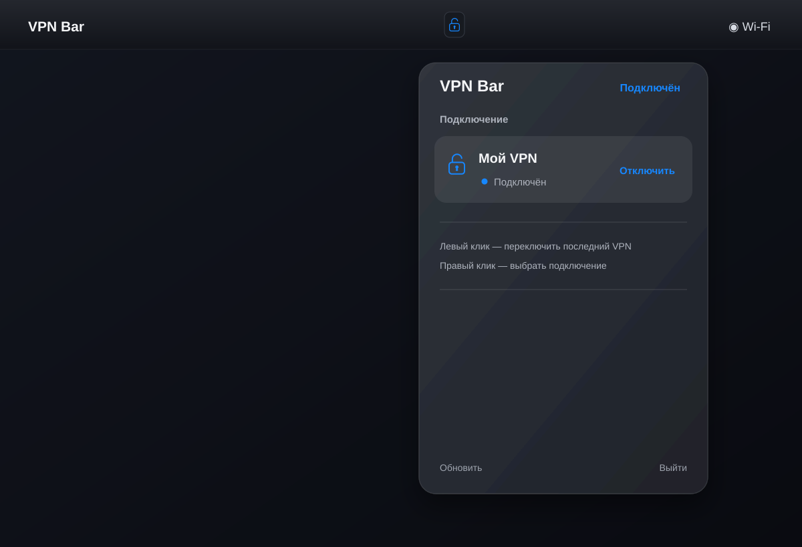
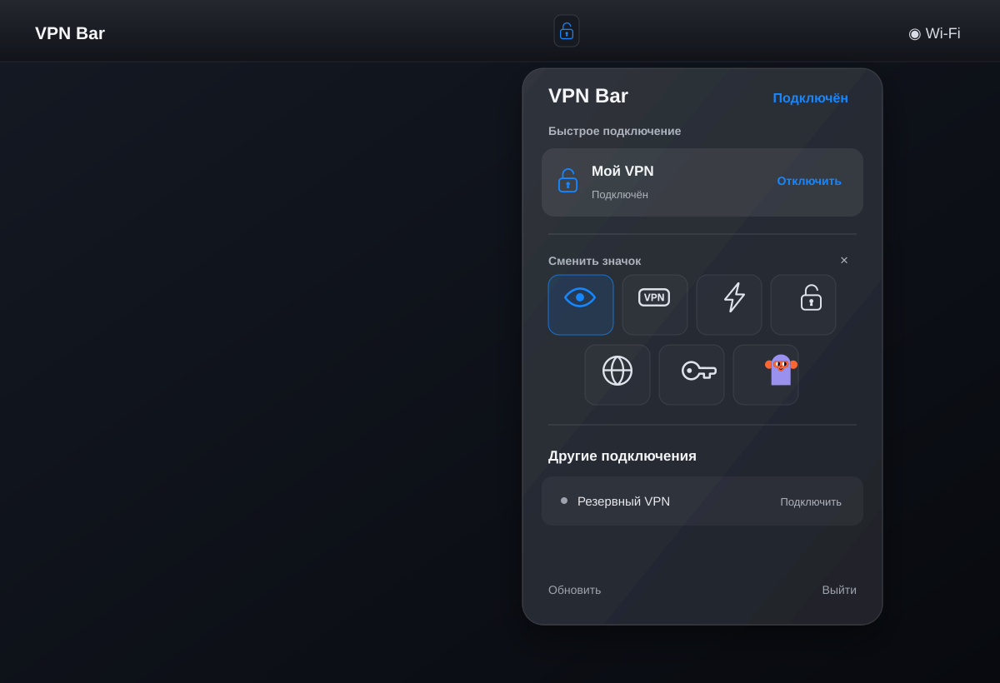
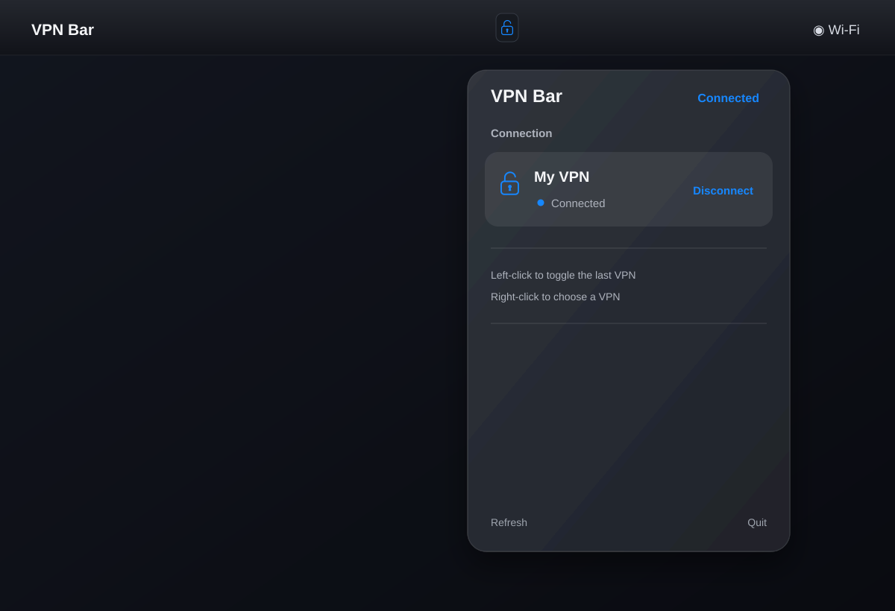
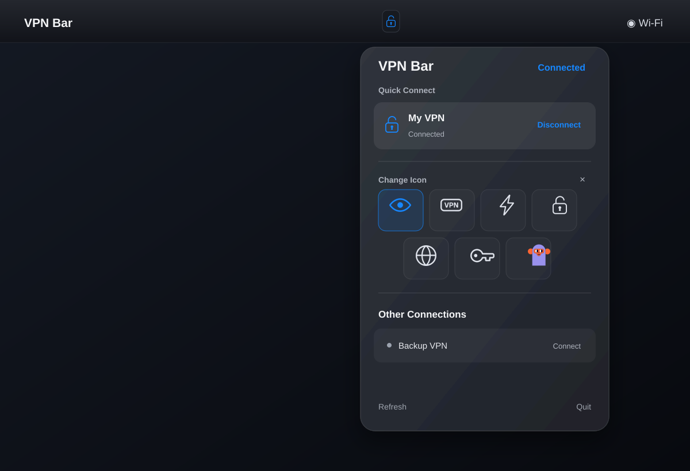

# VPN Bar

**Русский:** Небольшое приложение для macOS, которое управляет системными VPN-подключениями прямо из строки меню. Левый клик переключает последний выбранный VPN; правый клик открывает список подключений.

**English:** A small macOS menu bar app for controlling built-in VPN profiles. Left-click toggles the last selected VPN; right-click opens the connection list.

VPN Bar automatically uses **Russian when Russian is the primary language in macOS** and **English for every other system language**.

[Installer (.pkg)](https://github.com/alexus121/vpn-bar-macos/releases/download/v1.0.0-beta/VPN.Bar.Installer.pkg) · [App archive (.zip)](https://github.com/alexus121/vpn-bar-macos/releases/download/v1.0.0-beta/VPN.Bar.app.zip) · [Complete project (.zip)](https://github.com/alexus121/vpn-bar-macos/releases/download/v1.0.0-beta/VPN.Bar.Project.zip)

## Примеры интерфейса / Interface previews

### Русский интерфейс

### English interface

*Векторные превью интерфейса приложения / Vector previews of the app interface.*

## Русский

### Что это

VPN Bar позволяет быстро включать и выключать VPN-профили macOS, не открывая Системные настройки. Если подключений несколько, можно выбрать нужное из панели приложения. Цвет обычного значка при подключении подстраивается под акцентный цвет macOS; обезьянка сохраняет свои исходные варианты оформления.

Язык интерфейса выбирается автоматически: если основным языком macOS установлен русский, приложение будет на русском; при любом другом языке — на английском.

### Как пользоваться

1. Скачайте [установщик (.pkg)](https://github.com/alexus121/vpn-bar-macos/releases/download/v1.0.0-beta/VPN.Bar.Installer.pkg) или [архив приложения (.zip)](https://github.com/alexus121/vpn-bar-macos/releases/download/v1.0.0-beta/VPN.Bar.app.zip) из релиза. В архиве полного проекта установочные файлы находятся в папке `dist`.
2. Добавьте VPN-профиль в **Системные настройки → VPN**. Приложение видит системные профили macOS.
3. Запустите VPN Bar. **Левый клик** по значку в строке меню включает или выключает последний выбранный VPN; если VPN уже подключён, клик переключает активное подключение.
4. **Правый клик** по значку открывает панель со списком VPN. Выберите другой профиль, чтобы подключиться к нему.
5. Чтобы сменить значок, нажмите правой кнопкой на карточку подключения в панели и выберите **«Сменить значок»**. В сетке выбора значков показаны только изображения, без подписей.

### Совместимость и примечания

- macOS 13 или новее; сборка содержит версии для Apple silicon и Intel.
- Поддерживаются профили, отображаемые командой `scutil --nc list`. VPN-клиенты, которые работают только внутри собственного приложения и не добавляют системный профиль macOS, не отображаются.
- VPN Bar не хранит пароли: подключением управляет macOS с использованием сохранённых системных данных.
- Эта тестовая сборка не подписана сертификатом Developer ID и не нотариализована Apple. При первом запуске macOS может показать предупреждение безопасности.

## English

### What it is

VPN Bar lets you quickly turn macOS VPN profiles on or off without opening System Settings. When you have multiple profiles, choose one from the app panel. The connected color of regular icons follows the macOS accent color; the monkey keeps its original artwork and colors.

The interface language is selected automatically: VPN Bar uses Russian when Russian is the primary macOS language, and English for every other language.

### How to use it

1. Download the [installer (.pkg)](https://github.com/alexus121/vpn-bar-macos/releases/download/v1.0.0-beta/VPN.Bar.Installer.pkg) or [app archive (.zip)](https://github.com/alexus121/vpn-bar-macos/releases/download/v1.0.0-beta/VPN.Bar.app.zip) from the release. In the complete project archive, installation files are in `dist`.
2. Add a VPN profile in **System Settings → VPN**. VPN Bar works with profiles managed by macOS.
3. Open VPN Bar. **Left-click** its menu bar icon to toggle the last selected VPN; if a VPN is already connected, the click toggles the active connection.
4. **Right-click** the menu bar icon to open the VPN list. Choose another profile to connect to it.
5. To change the menu bar icon, right-click the connection card in the panel and choose **“Change Icon.”** The icon grid has no captions.

### Compatibility and notes

- macOS 13 or later; the build includes Apple silicon and Intel versions.
- VPN Bar detects profiles listed by `scutil --nc list`. VPN clients that only manage tunnels inside their own app and do not create a macOS system profile are not listed.
- VPN Bar does not store passwords. macOS manages the connection and uses credentials saved in the system.
- This test build is not signed with a Developer ID certificate or notarized by Apple. macOS may show a security warning on first launch.
